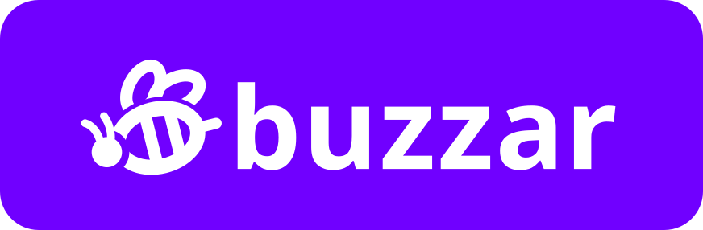

<div align="center">
  
  <br/>
  <br/>
  <h3>Try Buzzar at <a href="https://buzzar.haven.software">https://buzzar.haven.software</a></h3>
</div>

Buzzar is a platform for shared virtual worlds built on [Matrix](https://matrix.org): explore, build and hang out in
3D worlds with your Matrix account, wearing your own avatar, talking with spatial voice. Worlds, avatars and Things are
open glTF files their creators own, hosted on Matrix or anywhere else.

Buzzar is a fork of [Third Room](https://github.com/matrix-org/thirdroom), the Matrix.org Foundation's virtual world
client, whose development was paused in 2023. It works toward VRChat-level features (custom avatars, mirrors, scripted
worlds, VR, world moderation) while staying close to a standard Matrix client and opening existing Third Room
([MSC3815](https://github.com/matrix-org/matrix-spec-proposals/pull/3815)) worlds. Third Room's full commit history is
preserved here.

Documentation: **[haven.software/buzzar/docs](https://haven.software/buzzar/docs/)**, including how the
[engine and networking](https://haven.software/buzzar/docs/guides/architecture) work. Roadmap and VRChat feature-parity
checklist: [docs/buzzar](./docs/buzzar/).

## Getting Started

Use the hosted app at **[buzzar.haven.software](https://buzzar.haven.software)** with any Matrix account, or see
[Local Development](#local-development) to run it yourself. The
[Getting Started guide](https://haven.software/buzzar/docs/guides/) shows you around.

## Creating Your Own Content

### Worlds

A world is a glTF file, so any tool that exports glTF (Blender, Unity and others) can make one. Mirrors, seats,
grabbable objects, avatar pedestals, voice zones, screens and more come from Buzzar's
[`HAVEN_*` glTF extensions](./docs/gltf/index.md), and Mozilla Hubs scenes keep many of their components. See the
[creators guide](https://haven.software/buzzar/docs/guides/creators) and
[Importing Worlds](https://haven.software/buzzar/docs/guides/importing-worlds). Worlds can be scripted with the
[Web Scene Graph API](https://haven.software/buzzar/docs/guides/websg/).

### Avatars

Upload a `.vrm` or `.glb` humanoid (VRM, Mixamo or VRChat-style bone names) under **Change Avatar**, wear it everywhere
or in one world only, or pick one up from a world's pedestal. See the
[avatars guide](https://haven.software/buzzar/docs/guides/avatars).

### Things

Things are objects players spawn, grab and throw. Each is a glTF file whose physical behaviour (shape, weight, where it
appears) travels with it in [`HAVEN_thing`](./docs/gltf/HAVEN_thing/README.md), and each world chooses which Things
are allowed (**World Settings → Things**). Spawn the stock Things, or clones of them with your own size, colour,
bounciness, weight and glow. You can already upload your own Thing files to **My Things**; spawning them is still to
come.

## Homeserver Requirements

- **Synapse 1.62 or later** (or another homeserver that sends `Cross-Origin-Resource-Policy: cross-origin` on media
  downloads). Buzzar uses SharedArrayBuffers, which need a
  [secure, cross-origin isolated context](https://developer.mozilla.org/en-US/docs/Web/JavaScript/Reference/Global_Objects/SharedArrayBuffer#security_requirements),
  so world and avatar files must be loadable across origins.
- **LiveKit**, for world calls (the default call type): a [LiveKit](https://livekit.io) server plus the MatrixRTC
  authorization service ([lk-jwt-service](https://github.com/element-hq/lk-jwt-service)), announced in your
  `.well-known/matrix/client` under `org.matrix.msc4143.rtc_foci`. It's the same setup Element Call uses; see its
  [self-hosting guide](https://github.com/element-hq/element-call/blob/main/docs/self_hosting.md). Only whoever starts
  a world's call needs it: everyone who joins after them uses that server.
- **Delayed events** ([MSC4140](https://github.com/matrix-org/matrix-spec-proposals/pull/4140)), recommended: players
  who close the app without leaving drop out of the call within seconds instead of staying listed until their
  membership expires. In Synapse, set `max_event_delay_duration` (for example `24h`).
- **TURN**, for peer-to-peer (mesh) calls: a world can still choose a peer-to-peer call (World Settings → Calls), and
  Buzzar offers one when a LiveKit call can't connect. Those connect players directly, through your homeserver's TURN
  relay when a direct path fails; see Synapse's [TURN guide](https://element-hq.github.io/synapse/latest/turn-howto.html).

## Local Development

The Buzzar client can be ran locally against any Matrix homeserver in development.

After you've installed node.js locally, run the following commands.

```
npm install -g yarn
yarn
yarn dev
```

**NOTE: Vite does not transpile import statements in web workers and Chromium based browsers are the only browsers to support imports in Web Workers. In order to develop in non-chromium browsers, run the following command which will build the project after every change.**

```
yarn preview
```

Open http://localhost:3000

## Deployment

The Buzzar client can be deployed to any static web host with the ability for wildcard routing for single page web
apps and adding HTTP headers.

The [Dockerfile](./Dockerfile) builds the app and serves it with nginx, headers included
(`docker build -t buzzar . && docker run -p 8080:80 buzzar`); edit `config.json` first to choose the default
homeserver. Outside localhost, put it behind TLS: browsers only allow the microphone and shared memory on secure
origins.

Third Room deployed to Netlify with GitHub Actions workflows, which this repository still contains (they expect
Third Room's `main` and `prod` branches; Buzzar develops on `develop`). If you fork the repository and set the
`NETLIFY_AUTH_TOKEN` and `NETLIFY_SITE_ID` secrets, they can deploy your fork the same way.

To setup OIDC login client configs needs to be added in `config.json`. Client configs includes `client_id` and `uris` issued by OIDC Provider.

## Moderation Bot

The repository includes a small moderation bot for world hosts, in [`bot/`](./bot/). It runs on an ordinary Matrix
account on any homeserver, so you don't need to host a homeserver. It only does what general Matrix moderation tools
(Draupnir, Meowlnir) can't do for Buzzar worlds, such as copying bans from lists visitors can't read into your world.
Run one of those next to it for room bans, redactions and spam checks.

### Quickstart

You need [Node](https://nodejs.org) 22.18 or newer and a Matrix account for the bot (make a new one).

```bash
cd bot
npm install
cp config.example.json config.json
```

Fill in `config.json` with the bot account's homeserver, user ID and password, and your own account as an owner:

```json
{
  "homeserverUrl": "https://matrix.example.org",
  "userId": "@buzzar-bot:example.org",
  "password": "the bot account's password",
  "owners": ["@you:example.org"]
}
```

Start it with `npm start`. It logs in once and keeps its session in `bot/data/`, so you can remove the password from
`config.json` afterwards. Then, in Buzzar:

1. In your world's People list, choose **Invite to World** and invite the bot. It accepts invites only from its owners.
2. Open the ⋯ menu next to the bot and choose **Make Moderator**.
3. Follow ban lists in **World Settings → Moderation & Safety → Ban Lists**. The bot's report shows up under each list.

What the bot does, how to turn each feature on in a world, every setting, and how to keep it running are covered in the
**[Moderation Bot guide](https://haven.software/buzzar/docs/guides/moderation-bot)**.

## Open Source / License

Buzzar is completely open source under the [Apache 2.0 license](./LICENSE), the same license as Third Room. You can
check out this repository, fork it, and modify it as you please. Third Room, the project Buzzar is forked from, was
governed by the Matrix.org Foundation and developed in the open; its original development discussion took place in the
[#thirdroom-dev:matrix.org](https://matrix.to/#/%23thirdroom-dev:matrix.org) Matrix room. Buzzar is developed at
[Haven-Organization/buzzar](https://github.com/Haven-Organization/buzzar).
